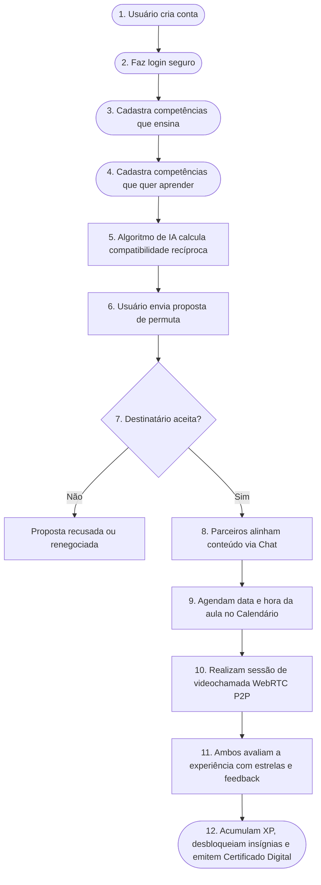

# ESPECIFICAÇÃO DE ENGENHARIA DE SOFTWARE (SPEC)
## PROJETO: SkillSwap — Plataforma Colaborativa de Troca de Conhecimentos
**Metodologia:** Spec-Driven Development (SDD)  
**Versão:** 1.0.0  
**Status:** Aprovada e Implementada  
**Data:** Outubro de 2026  

---

## 1. Objetivo do Projeto
Desenvolver uma plataforma web completa chamada **SkillSwap** que permita que pessoas ensinem e aprendam habilidades através da troca recíproca de conhecimentos, sem a utilização de moeda ou qualquer transação financeira.

O objetivo central é democratizar o acesso ao aprendizado prático, reduzir a zero os custos de capacitação técnica/profissional e fomentar a economia colaborativa por meio de uma comunidade engajada e fundamentada na permuta simétrica de saberes.

---

## 2. Atores e Perfis de Acesso (RBAC)

### 2.1 Usuário Comum (`USER`)
O participante ativo da comunidade que ensina e aprende.
**Permissões e Ações:**
* Criar conta e realizar login seguro;
* Recuperar senha com token criptográfico de tempo limitado;
* Editar perfil público (biografia, disponibilidade, localização e links);
* Cadastrar habilidades que domina e tem capacidade de ensinar;
* Cadastrar habilidades que deseja aprender com níveis de proficiência;
* Pesquisar e descobrir outros usuários;
* Receber recomendações personalizadas pelo Algoritmo Inteligente de Compatibilidade (IA Match);
* Enviar propostas formais de troca bilateral de conhecimento;
* Aceitar ou recusar solicitações de troca recebidas;
* Conversar em tempo real pelo chat integrado;
* Realizar videochamadas ao vivo via WebRTC (com compartilhamento de tela e áudio/vídeo);
* Agendar e gerenciar calendário de aulas;
* Avaliar outros usuários (nota de 1 a 5 estrelas e comentários);
* Submeter certificados e diplomas para obtenção de selo verificado;
* Acumular pontos de gamificação (XP), desbloquear insígnias e emitir certificados digitais com hash de validação pública;
* Registrar denúncias de comportamentos inadequados à moderação.

### 2.2 Administrador (`ADMIN`)
O moderador e gestor da integridade do ecossistema.
**Permissões e Ações:**
* Acessar o Painel Administrativo exclusivo (`/admin`);
* Visualizar métricas operacionais consolidadas em tempo real;
* Auditar e gerenciar a base de usuários cadastrados;
* Avaliar e aprovar ou rejeitar solicitações de verificação profissional de instrutores;
* Analisar, resolver ou arquivar denúncias da comunidade;
* Moderar conteúdos, feedbacks e remover condutas abusivas;
* Administrar o catálogo taxonômico de categorias e habilidades.

---

## 3. Casos de Uso Principais (Use Cases)
* **UC01:** Cadastro de novo usuário
* **UC02:** Autenticação e gestão de sessão (Login/Logout)
* **UC03:** Recuperação e redefinição de senha
* **UC04:** Gestão de catálogo de habilidades (ensinar e aprender)
* **UC05:** Descoberta e pesquisa de membros com IA Match
* **UC06:** Envio, aceitação e recusa de propostas de permuta
* **UC07:** Comunicação bilateral via chat direto
* **UC08:** Agendamento de aulas com prevenção de conflitos
* **UC09:** Realização de videochamada WebRTC privativa
* **UC10:** Avaliação pós-aula e pontuação de reputação
* **UC11:** Conquista de insígnias e gamificação (XP)
* **UC12:** Emissão e validação pública de certificado digital
* **UC13:** Submissão e auditoria de verificação profissional
* **UC14:** Registro e moderação de denúncias no painel administrativo

---

## 4. Requisitos Funcionais (RF)

* **RF01 – Cadastro de usuários:** O sistema deve permitir que novos usuários criem conta fornecendo nome, e-mail único e senha forte. Deve aplicar hash criptográfico na senha e conceder bônus de 50 XP de boas-vindas.
* **RF02 – Login:** O sistema deve autenticar o usuário validando credenciais, emitindo token JWT armazenado em cookie seguro `HttpOnly` com validade de 7 dias.
* **RF03 – Recuperação de senha:** O sistema deve prover fluxo de solicitação de recuperação de senha sem vazar a existência do e-mail na base pública.
* **RF04 – Perfil do usuário:** O sistema deve disponibilizar edição de bio, disponibilidade horária, cidade/estado, telefone e links profissionais.
* **RF05 – Cadastro das habilidades que ensina:** O sistema deve permitir registrar competências ofertadas com níveis de proficiência (Iniciante, Intermediário, Avançado, Especialista) e descrição.
* **RF06 – Cadastro das habilidades que deseja aprender:** O sistema deve permitir registrar competências almejadas e metas de estudo.
* **RF07 – Pesquisa de usuários:** O sistema deve fornecer busca por nome, termos de competência, áreas e categorias.
* **RF08 – Algoritmo inteligente de compatibilidade:** O sistema deve calcular automaticamente a afinidade mútua ($0$ a $100\%$) baseando-se no cruzamento bilateral de habilidades, avaliações, horários e localização.
* **RF09 – Solicitação de troca:** O sistema deve permitir propor permuta formal selecionando a habilidade oferecida, a habilidade desejada e nota explicativa.
* **RF10 – Aceitar ou recusar solicitações:** O destinatário deve poder aprovar ou rejeitar propostas recebidas, atualizando o status do relacionamento.
* **RF11 – Chat integrado:** O sistema deve prover mensageria direta entre parceiros de troca para alinhamento pedagógico e de horários.
* **RF12 – Videochamadas:** O sistema deve prover sala de videoconferência em tempo real via WebRTC com controles de áudio, vídeo e compartilhamento de tela.
* **RF13 – Agenda de aulas:** O sistema deve permitir agendar datas, horários e duração de sessões vinculadas a uma troca aceita, gerando o link da sala virtual.
* **RF14 – Sistema de avaliações:** Após aulas, os participantes devem avaliar o parceiro com nota de 1 a 5 estrelas e comentário, impactando a pontuação e reputação.
* **RF15 – Sistema de denúncias:** Usuários devem poder denunciar violações (ex: cobrança financeira indevida, assédio, faltas reiteradas) diretamente à moderação.
* **RF16 – Verificação de certificados:** Instrutores em áreas reguladas devem poder submeter diplomas para análise e homologação de selo verificado.
* **RF17 – Painel administrativo:** Administradores devem dispor de dashboard com métricas de uso, moderação de denúncias e homologação de comprovantes.
* **RF18 – Sistema de notificações:** Alertas visuais e indicadores in-app sobre solicitações pendentes, agendamentos e mensagens.
* **RF19 – Gamificação:** Mecânica estilo Duolingo com contagem de pontos de experiência (XP), níveis e desbloqueio de insígnias de mérito.
* **RF20 – Certificados digitais:** Geração de certificados formais com código de verificação criptográfico único validável em rota pública (`/certificado/[code]`).

---

## 5. Requisitos Não Funcionais (RNF) e Segurança

* **RNF01 – Segurança de Senhas:** Hashing unidirecional com `bcryptjs` utilizando salt rounds 12.
* **RNF02 – Autenticação Criptográfica:** Tokens JWT assinados com algoritmo HS256 via biblioteca `jose`, transmitidos estritamente em cookies `HttpOnly`, `SameSite=Lax` e `Secure`.
* **RNF03 – Prevenção contra SQL Injection:** Camada de persistência relacional com Prepared Statements nativos via Prisma ORM.
* **RNF04 – Prevenção contra XSS & CSRF:** Sanitização e validação de todas as entradas no servidor através de esquemas Zod; proteção nativa contra CSRF via Server Actions e cookies de escopo estrito.
* **RNF05 – Controle de Acesso por Papel (RBAC):** Middleware Edge interceptando todas as rotas protegidas e validando roles (`USER` e `ADMIN`).
* **RNF06 – Interface Responsiva:** Layout adaptável para smartphones, tablets e desktops (Mobile-First) desenvolvido com Tailwind CSS.
* **RNF07 – Performance:** Renderização no servidor com React Server Components (RSC) para carregamento instantâneo e pontuação máxima no Core Web Vitals.
* **RNF08 – Banco de Dados Relacional:** Modelo relacional normalizado no PostgreSQL com restrições de integridade referencial ACID e índices otimizados.
* **RNF09 – Resiliência Operacional:** Camada de repositório híbrida com fallback em memória que garante disponibilidade contínua em demonstrações locais ou ambientes serverless desacoplados.
* **RNF10 – Configuração por Ambiente:** Isolamento de segredos e endpoints em variáveis de ambiente (`.env`).
* **RNF11 – Preparado para Deploy:** Compatibilidade zero-config com a infraestrutura serverless do Vercel e bancos de dados PostgreSQL em nuvem (Neon, Supabase, Vercel Postgres).

---

## 6. Modelo de Dados (DER — 16 Tabelas Relacionais)

```
┌──────────────┐       1:1       ┌──────────────┐
│     User     ├─────────────────┤   Profile    │
└──────┬───────┘                 └──────────────┘
       │
       ├──────── 1:1 ──────────── Administrador (Administrator)
       │
       ├──────── 1:N ──────────── UserSkill (Habilidades do Usuário) ────── N:1 ── Skill ── N:1 ── Category
       │
       ├──────── 1:N (Requester) ─┐
       │                          ├─ ExchangeRequest (Solicitações de Troca)
       ├──────── 1:N (Receiver) ──┘         │
       │                                    ├─ 1:N ── ScheduledClass (Agendamentos) ── 1:N ── VideoCallSession
       │                                    └─ 1:N ── Review (Avaliações)
       ├──────── 1:N ──────────── ChatMessage (Mensagens de Chat)
       │
       ├──────── 1:N ──────────── ProfessionalVerification (Verificações)
       │
       ├──────── 1:N ──────────── Report (Denúncias)
       │
       ├──────── 1:N ──────────── Notification (Notificações)
       │
       ├──────── 1:N ──────────── UserAchievement ── N:1 ── Achievement (Conquistas)
       │
       └──────── 1:N ──────────── Certificate (Certificados Digitais)
```

### 6.1 Detalhamento das 16 Entidades
1. **User (Usuários):** `id`, `name`, `email`, `passwordHash`, `role` (USER|ADMIN), `points`, `isVerified`, `resetToken`, `resetTokenExp`, `createdAt`, `updatedAt`.
2. **Profile (Perfis):** `id`, `userId` (FK), `bio`, `avatarUrl`, `location`, `availability`, `phone`, `linkedinUrl`, `githubUrl`, `createdAt`, `updatedAt`.
3. **Administrator (Administradores):** `id`, `userId` (FK), `department`, `canManageUsers`, `canVerifyCertificates`, `canModerateReports`, `canManageCategories`, `lastLoginAt`.
4. **Category (Categorias):** `id`, `name`, `description`, `icon`, `createdAt`.
5. **Skill (Habilidades):** `id`, `name`, `description`, `categoryId` (FK), `createdAt`, `updatedAt`.
6. **UserSkill (Habilidades do Usuário):** `id`, `userId` (FK), `skillId` (FK), `type` (TEACHING|LEARNING), `proficiency` (BEGINNER|INTERMEDIATE|ADVANCED|EXPERT), `description`, `createdAt`.
7. **ExchangeRequest (Solicitações de Troca):** `id`, `requesterId` (FK), `receiverId` (FK), `offeredSkillId` (FK), `desiredSkillId` (FK), `status` (PENDING|ACCEPTED|REJECTED|COMPLETED|CANCELLED), `proposalNote`, `createdAt`, `updatedAt`.
8. **ScheduledClass (Agendamentos):** `id`, `exchangeRequestId` (FK), `teacherId` (FK), `studentId` (FK), `title`, `description`, `scheduledAt`, `durationMinutes`, `status` (SCHEDULED|COMPLETED|CANCELLED), `meetingRoomId`, `createdAt`.
9. **VideoCallSession (Videochamadas):** `id`, `roomId`, `initiatorId` (FK), `scheduledClassId` (FK), `status` (WAITING|ACTIVE|ENDED), `startedAt`, `endedAt`, `createdAt`.
10. **ChatMessage (Mensagens):** `id`, `senderId` (FK), `receiverId` (FK), `content`, `isRead`, `createdAt`.
11. **Review (Avaliações):** `id`, `exchangeRequestId` (FK), `reviewerId` (FK), `reviewedUserId` (FK), `rating` (1-5), `comment`, `isModerated`, `createdAt`.
12. **ProfessionalVerification (Verificações):** `id`, `userId` (FK), `professionTitle`, `documentUrl`, `status` (PENDING|APPROVED|REJECTED), `feedback`, `createdAt`, `reviewedAt`.
13. **Report (Denúncias):** `id`, `reporterId` (FK), `reportedUserId` (FK), `reportedContent`, `reason`, `description`, `status` (PENDING|RESOLVED|DISMISSED), `adminNotes`, `createdAt`, `resolvedAt`.
14. **Notification (Notificações):** `id`, `userId` (FK), `title`, `message`, `link`, `type`, `isRead`, `createdAt`.
15. **Achievement (Conquistas):** `id`, `code`, `title`, `description`, `icon`, `pointsReward`, `createdAt`.
16. **UserAchievement (Pivô de Conquistas):** `id`, `userId` (FK), `achievementId` (FK), `unlockedAt`.
17. **Certificate (Certificados Digitais):** `id`, `userId` (FK), `title`, `skillName`, `description`, `hoursCompleted`, `verificationCode` (Unique Hash), `issuedAt`.

---

## 7. Fluxo Operacional da Plataforma



---

## 8. Especificação do Algoritmo Inteligente de Compatibilidade (IA Match)

O motor avalia o vetor de características do usuário autenticado ($U_A$) em relação a cada candidato disponível ($U_B$) produzindo o **Score de Compatibilidade** ($0 \le S \le 100\%$):

$$S = S_{\text{skills}} + S_{\text{reputation}} + S_{\text{availability}} + S_{\text{categories}} + S_{\text{location}} + S_{\text{verified}}$$

1. **Permuta Bilateral Perfeita ($S_{\text{skills}} = 50\%$):**
   * Se $U_B$ ensina o que $U_A$ quer aprender **E** $U_A$ ensina o que $U_B$ quer aprender: $+50$ pontos.
   * Se a compatibilidade for unilateral: $+30$ ou $+20$ pontos.
2. **Reputação da Comunidade ($S_{\text{reputation}} = 20\%$):**
   * $\text{Score} = \left(\frac{\text{Média de Estrelas}}{5.0}\right) \times 20$.
   * Membros novos sem avaliações recebem baseline de incentivo de $+15$ pontos.
3. **Harmonia de Disponibilidade ($S_{\text{availability}} = 15\%$):**
   * Coincidência de turnos preferenciais (manhã, tarde, noite ou finais de semana): $+15$ pontos.
4. **Categorias e Interesses Afins ($S_{\text{categories}} = 10\%$):**
   * Interseção de categorias taxonômicas: $+10$ pontos.
5. **Proximidade Geográfica Opcional ($S_{\text{location}} = 5\%$):**
   * Mesma cidade ou estado: $+5$ pontos.
6. **Bônus de Qualificação Profissional ($S_{\text{verified}} = +5\%$):**
   * Perfil com selo verificado pela moderação: $+5$ pontos.

---

## 9. Diretrizes de Interface e Design System

A interface unifica referências de três produtos globais:
* **LinkedIn:** Confiança corporativa, tipografia limpa, paleta azul (`#2563eb`), cards de perfis profissionais, histórico e selos de validação.
* **Discord:** Canais de mensagens em tempo real, painéis escuros imersivos para chamadas de áudio e vídeo, controles rápidos de microfone, câmera e tela.
* **Duolingo:** Gamificação viva com acentos verdes (`#10b981`), contadores de XP destacados, feedback visual de conquista e progressão contínua.

---

## 10. Matriz de Rastreabilidade de Implementação

| Requisito | Arquivo de Implementação | Teste Automatizado |
| :--- | :--- | :--- |
| **RF01 / RF02** | `src/services/auth.service.ts` / `src/app/actions/auth.actions.ts` | `scripts/run-tests.ts` (Hash & JWT) |
| **RF03** | `src/app/(auth)/recuperar-senha/page.tsx` | Validação de fluxo no servidor |
| **RF04** | `src/app/(dashboard)/perfil/page.tsx` | Edição com Zod Schema |
| **RF05 / RF06** | `src/app/(dashboard)/habilidades/page.tsx` | `scripts/run-tests.ts` (AddUserSkillSchema) |
| **RF07 / RF08** | `src/lib/match.ts` / `src/services/match.service.ts` | `scripts/run-tests.ts` (calculateMatchScore) |
| **RF09 / RF10** | `src/services/exchange.service.ts` / `src/app/(dashboard)/trocas/page.tsx` | Transição de estados PENDING/ACCEPTED |
| **RF11** | `src/components/chat/ChatContainer.tsx` / `src/services/chat.service.ts` | Validação de mensagens Zod |
| **RF12** | `src/components/video/VideoRoom.tsx` / `src/app/(dashboard)/aula/[id]/page.tsx` | WebRTC P2P Mesh |
| **RF13** | `src/services/schedule.service.ts` / `src/app/(dashboard)/agenda/page.tsx` | Agendamento com Zod |
| **RF14** | `src/services/review.service.ts` / `src/app/actions/review.actions.ts` | `scripts/run-tests.ts` (CreateReviewSchema) |
| **RF15** | `src/app/(dashboard)/denuncias/page.tsx` / `src/services/admin.service.ts` | Moderação no Painel Admin |
| **RF16** | `src/app/(dashboard)/perfil/page.tsx` / `src/services/admin.service.ts` | Homologação documental |
| **RF17** | `src/app/(admin)/admin/page.tsx` | Controle de acesso RBAC |
| **RF18** | `src/components/layout/AppNavbar.tsx` / Dashboards | Alertas visuais in-app |
| **RF19** | `src/services/gamification.service.ts` / `src/app/(dashboard)/conquistas/page.tsx` | Contagem de XP e Badges |
| **RF20** | `src/app/certificado/[code]/page.tsx` | Validação pública por código único |
