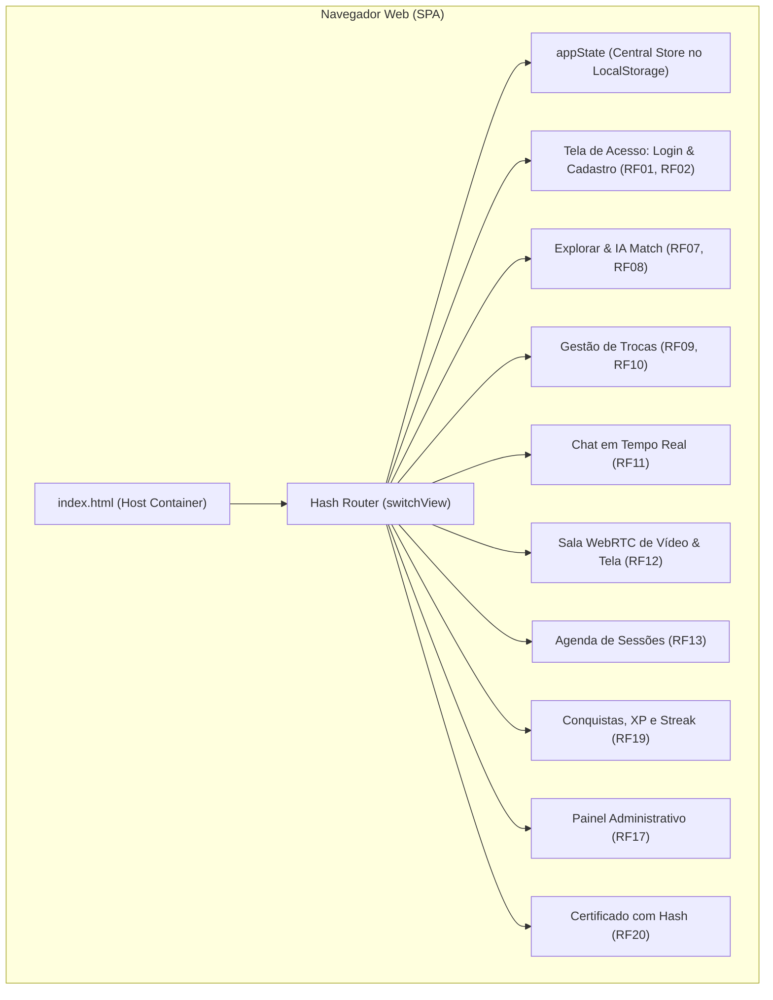

# 🔄 SkillSwap — Plataforma Colaborativa de Troca de Conhecimentos
> **Economia Colaborativa, Democratização do Saber e Permuta Recíproca com Moeda Zero**  
> *Engenharia de Software baseada em Spec-Driven Development (SDD)*

---

## 📌 1. Resumo do Projeto

O **SkillSwap** é uma plataforma web colaborativa criada com o propósito de permitir que pessoas ensinem e aprendam habilidades através da **troca recíproca e simétrica de conhecimentos**, sem a utilização de dinheiro ou qualquer cobrança financeira (**Princípio da Moeda Zero**: *1 hora ensinando = 1 hora aprendendo*).

O objetivo central é democratizar o acesso ao aprendizado prático de qualidade, eliminar os custos financeiros de capacitação técnica ou profissional e fomentar uma comunidade engajada baseada na solidariedade intelectual e no aprendizado contínuo.

### 👥 Perfis de Acesso (RBAC)
* **Usuário Comum (`USER`)**: Cria perfil, cadastra o que domina e o que quer aprender, busca parceiros via IA Match, envia/recebe propostas de permuta, conversa por chat, realiza videoaulas WebRTC, avalia parceiros, acumula XP e emite certificados.
* **Administrador (`ADMIN`)**: Acessa o Painel de Controle exclusivo (`/admin`), acompanha métricas em tempo real, gerencia e audita usuários, homologa pedidos de verificação profissional de instrutores e modera denúncias da comunidade.

---

## 🚀 2. Funcionalidades Implementadas

A plataforma implementa integralmente os **20 Requisitos Funcionais (RF01 a RF20)** e os **14 Casos de Uso (UC01 a UC14)** definidos na especificação:

### 🔐 Autenticação, Cadastro e Sessão (RF01, RF02, RF03)
* **Tela de Acesso Unificada**: Alternância fluida entre as abas **Entrar (Login)** e **Criar Conta (Cadastro)**.
* **Login Seguro**: Autenticação com e-mail e senha, botão de visibilidade de senha (olho para exibir/ocultar) e opção de "Lembrar meu acesso".
* **Contas de Demonstração Rápidas**: Acesso direto com 1 clique para testar as personas do sistema (*Ana Silva*, *Carlos Mendes*, *Rodrigo Admin*).
* **Cadastro Completo (+50 XP de Boas-vindas)**: Formulário com validação de formato de e-mail, duplicidade, confirmação de senha, medidor dinâmico de força da senha (Fraca, Média, Forte), interesses iniciais e aceite do termo Moeda Zero.
* **Recuperação de Senha**: Modal interativo que simula o disparo de link de recuperação com token criptográfico de tempo limitado (**RF03**).
* **Logout Seguro**: Encerramento de sessão com retorno imediato à tela de acesso e proteção de rotas restritas.

### 👤 Perfil e Catálogo de Conhecimentos (RF04, RF05, RF06)
* **Edição de Perfil**: Gerenciamento de foto/avatar, biografia, cidade/estado, disponibilidade horária (manhã, tarde, noite, fins de semana) e links de redes profissionais (LinkedIn e GitHub).
* **Catálogo "Ensino"**: Registro de habilidades ofertadas com proficiência (*Iniciante*, *Intermediário*, *Avançado*, *Especialista*) e descrição didática.
* **Catálogo "Quero Aprender"**: Registro de habilidades almejadas com metas de estudo personalizadas.

### 🧠 Descoberta e Inteligência de Compatibilidade (RF07, RF08)
* **Busca e Filtros Avançados**: Pesquisa em tempo real por termos de busca, áreas de atuação e disponibilidade.
* **Algoritmo IA Match 2.0**: Cruzamento bilateral automatizado que calcula afinidade mútua de $0\%$ a $100\%$ baseado na equação de 6 vetores:
  $$\text{Score} = S_{\text{skills}} (50) + S_{\text{reputação}} (20) + S_{\text{disponibilidade}} (15) + S_{\text{categorias}} (10) + S_{\text{localização}} (5) + S_{\text{verificado}} (5)$$
* **Breakdown de Compatibilidade**: Modal explicativo que detalha exatamente o porquê de o algoritmo ter recomendado determinado usuário.

### 🤝 Gestão de Trocas Bilaterais (RF09, RF10)
* **Proposta Formal de Permuta**: Envio de solicitação vinculando a habilidade oferecida, a habilidade desejada e nota explicativa.
* **Painel de Trocas**: Controle de status (*Pendentes*, *Aceitas*, *Concluídas*, *Recusadas*), com alertas visuais e contadores interativos.

### 💬 Comunicação e Salas Virtuais (RF11, RF12, RF13)
* **Chat Integrado em Tempo Real**: Mensageria direta para alinhamento pedagógico e troca de links.
* **Sala de Videochamada WebRTC P2P**: Sala de aula virtual completa no navegador com:
  * Controles de áudio (mutar/desmutar) e vídeo (ligar/desligar câmera).
  * Compartilhamento de tela em tempo real (*Screen Share*).
  * Chat lateral em tempo real integrado à chamada.
  * Painel de notas colaborativas da aula.
* **Agenda de Aulas**: Agendamento de datas, horários e duração de sessões vinculadas a trocas aceitas, gerando o link direto para a sala virtual.

### ⭐ Reputação, Moderação e Segurança (RF14, RF15, RF16, RF17)
* **Avaliações Pós-Aula**: Sistema de nota de 1 a 5 estrelas e depoimento textual, impactando a reputação pública do instrutor.
* **Sistema de Denúncias**: Canal direto para denunciar violações de conduta ou tentativas indevidas de cobrança financeira.
* **Verificação Profissional de Instrutores**: Submissão de certificados e diplomas com análise documental para homologação de selo verificado.
* **Painel Administrativo Completo (`/admin`)**:
  * Visão geral de métricas: usuários ativos, trocas concluídas, horas trocadas e denúncias.
  * Tabela de auditoria e gerenciamento de membros cadastrados.
  * Fila de moderação de denúncias (resolver/arquivar).
  * Fila de homologação de solicitações de selo verificado.

### 🏆 Gamificação e Certificação Digital (RF18, RF19, RF20)
* **Gamificação Estilo Duolingo**:
  * Barra de progresso de experiência (XP) com contagem de níveis (Nv. 1 a Nv. 5).
  * Contador de sequência de dias consecutivos (*Streak Days* com ícone de chama).
  * Notificações flutuantes animadas a cada ganho de XP.
  * Galeria de insígnias de mérito desbloqueáveis (*Primeiro Passo*, *Mestre do Saber*, *Incansável*, etc.).
  * Celebração com animação de chuva de confetes (`canvas-confetti`).
* **Certificado Digital Formal**:
  * Emissão de comprovante oficial com código criptográfico único (*Hash de Validação*).
  * Visualização pública de validação em rota de certificado (`#certificado`).
  * Moldura clássica com selo dourado e suporte nativo à impressão/PDF (`Ctrl + P`).

---

## 🛠️ 3. Tecnologias Utilizadas

| Camada / Função | Tecnologia | Descrição e Aplicação |
| :--- | :--- | :--- |
| **Linguagem Base** | JavaScript (ES6+ Vanilla) | Lógica modular, reatividade de estado, roteamento por hash e controladores de evento. |
| **Marcação** | HTML5 Semântico | Estrutura limpa, acessível e otimizada para SEO e Single Page Application (SPA). |
| **Estilização** | Tailwind CSS (CDN) + CSS3 | Design system em Dark Mode, classes utilitárias responsivas e animações personalizadas. |
| **Tipografia** | Google Fonts (*Inter* e *Outfit*) | Fontes modernas focadas em legibilidade e hierarquia visual refinada. |
| **Ícones** | Lucide Icons | Pacote moderno de ícones vetoriais consistentes em SVG. |
| **Tempo Real & Vídeo** | WebRTC APIs / MediaStream | Infraestrutura nativa de captura de áudio, vídeo e compartilhamento de tela no navegador. |
| **Efeitos Visuais** | Canvas Confetti API | Motor de partículas comemorativas para recompensas de gamificação. |
| **Persistência de Estado** | LocalStorage API | Camada resiliente de armazenamento local do estado global da plataforma (`appState`). |
| **Ambiente de Hospedagem** | Apache (XAMPP) / Navegador Web | Compatibilidade total com servidores locais PHP/Apache ou abertura direta como arquivo estático. |

---

## 🏗️ 4. Estrutura do Sistema

```
c:\xampp\htdocs\skillswap\
│
├── index.html                   # Casca da SPA: imports (Tailwind, Lucide, Confetti), containers e rodapé
├── app.js                       # Cérebro da aplicação: State Store, Router, Telas (Views) e Handlers
├── styles.css                   # Design System: variáveis de cores, glassmorphism, animações e impressão
├── README.md                    # Este documento consolidado de arquitetura e manual de execução
└── Desenvolvimento do trabalho.md # Especificação Formal de Engenharia de Software (SDD)
```

### 🧩 Arquitetura de Software e Fluxo de Dados
A aplicação opera como uma **SPA (Single Page Application)** orientada a componentes funcionais e estado reativo:



1. **State Store Unificado (`appState`)**: Centraliza os dados de `currentUser`, `users`, `exchanges`, `messages`, `scheduledClasses`, `reviews`, `verifications`, `reports`, `notifications` e `achievements`.
2. **Hidratação & Fallback Automático**: Caso o `localStorage` esteja vazio, o sistema inicializa automaticamente com uma base de dados mockada completa e funcional.
3. **Roteamento Hash Dinâmico (`#view`)**: As páginas alternam suavemente sem recarregar a janela através da função `switchView(viewName)`.

---

## 💻 5. Instruções de Execução

O projeto foi construído para ser executado de forma simples e imediata, sem necessidade de comandos complexos de compilação ou instalação de dependências pesadas (`node_modules`).

### Método 1: Via Servidor Local XAMPP / Apache (Recomendado)
1. Certifique-se de que a pasta `skillswap` está localizada em `C:\xampp\htdocs\skillswap`.
2. Abra o **XAMPP Control Panel**.
3. Clique em **"Start"** ao lado do módulo **Apache**.
4. Abra seu navegador web (Chrome, Edge, Firefox, Brave) e acesse:
   * 🔗 **http://localhost/skillswap/**
   * 🔗 **http://localhost/skillswap/#auth** *(para ir direto à tela de login/cadastro)*

### Método 2: Execução Direta no Navegador (Sem servidor)
1. Navegue até a pasta `C:\xampp\htdocs\skillswap` no Explorador de Arquivos do Windows.
2. Dê um duplo clique no arquivo `index.html` (ou clique com o botão direito e selecione *Abrir com > Google Chrome*).
3. Ou cole diretamente na barra de endereço do navegador:
   * `file:///c:/xampp/htdocs/skillswap/index.html#auth`

---

## 🔑 6. Credenciais de Demonstração (Demo)

Para testar todas as funcionalidades do sistema, utilize as credenciais pré-configuradas abaixo:

| Nome do Usuário | E-mail de Acesso | Senha Padrão | Perfil (Role) | Especialidades |
| :--- | :--- | :--- | :--- | :--- |
| **Ana Silva** | `ana.silva@tech.com` | `123456` | `USER` | Ensina React/TypeScript, quer aprender Figma e Inglês |
| **Carlos Mendes** | `carlos.mendes@design.com` | `123456` | `USER` | Lead UX Designer, especialista em Design Systems |
| **Beatriz Lima** | `beatriz.lima@lingua.com` | `123456` | `USER` | Professora de Idiomas (Inglês e Espanhol) |
| **Gabriel Rocha** | `gabriel.rocha@data.com` | `123456` | `USER` | Cientista de Dados (Python, SQL e Pandas) |
| **Rodrigo Moderador**| `admin@skillswap.com` | `123456` | `ADMIN` | Administrador Geral do Sistema e Moderação |

> 💡 **Dica de Teste Rápido:** Na tela de login, há uma seção de **"Contas Demo Rápidas (1 Clique)"** que preenche as credenciais e realiza o login imediatamente com feedback visual e confetes.

